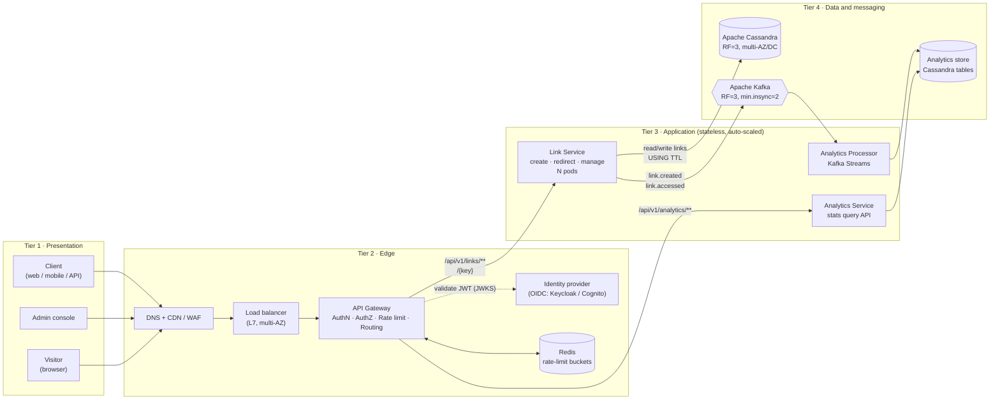
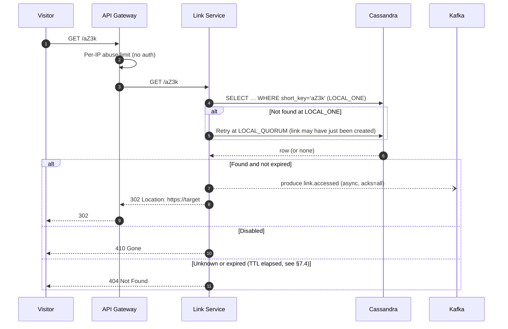
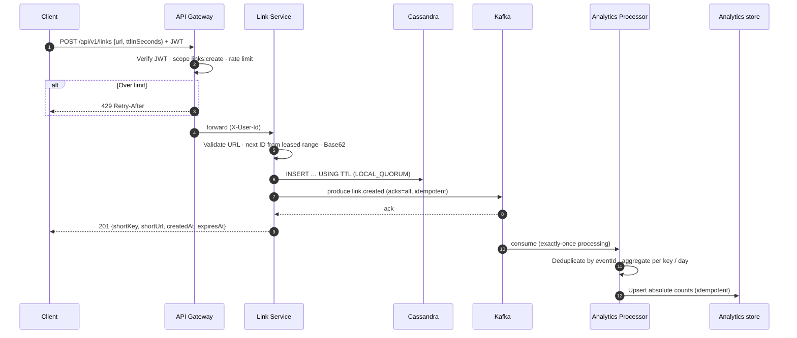

# Target Architecture: URL Shortener

| | |
|---|---|
| **Status** | Proposed |
| **Date** | 2026-10-13 |
| **Related** | [01-scope-green-field.md](01-scope-green-field.md) (what), [02-scope-brown-field.md](02-scope-brown-field.md) (work on the current code) |

---

## 1. Context and goals

The current service is a single Spring Boot application with in-memory H2 and in-process Spring events. This document describes the **target production architecture**:

| # | Requirement | Where it's addressed |
|---|-------------|---------------------|
| 1 | Multi-tier design with two kinds of end user: **Client** and **Admin** | [§3](#3-architecture-overview), [§4](#4-tiers-and-components) |
| 2 | All traffic goes through an **API Gateway** that authenticates and authorizes access to the create API | [§5](#5-api-gateway-authentication-authorization-and-rate-limiting) |
| 3 | The gateway **rate-limits** the create API | [§5.3](#53-rate-limiting) |
| 4 | **Horizontally scalable** backend that stores links in **NoSQL** (Cassandra preferred, DynamoDB as an alternative) | [§6](#6-link-service-horizontally-scalable), [§7](#7-data-tier-apache-cassandra) |
| 5 | Per-record **time to live**, with expired records removed automatically | [§7.4](#74-time-to-live-and-automatic-clean-up) |
| 6 | **Asynchronous analytics** (create and hit events) through **Kafka**, with no event loss on failures | [§8](#8-asynchronous-analytics-with-kafka) |

### 1.1 Capacity assumptions

These are working numbers for sizing. Revise them once real traffic is known.

| Metric | Assumption | Notes |
|--------|-----------|-------|
| Links created | 10 M/day (~115/s average, **1,000/s peak**) | Writes are rate-limited at the gateway |
| Redirects | 100:1 read/write ratio, about **100,000/s peak** | Redirects are the hot path |
| Record size | ~500 B (key, URL, metadata) | ×3 replicas |
| Raw storage | ~1.8 TB/year before replication, ~5.5 TB with RF = 3 | TTL expiry reduces this |
| Redirect latency | p99 < 20 ms at the service, < 50 ms end to end | Single-partition Cassandra read at `LOCAL_ONE` |
| Availability | 99.95 % for redirects | Redirects keep working when analytics is down |

---

## 2. Actors

| Actor | Who | What they can do | Authentication |
|-------|-----|------------------|---------------|
| **Client** | Registered user or an application using an API key | Create short links (with an optional TTL), list and view their own links, see their own link stats, disable their own links | OAuth 2.0 / OIDC access token (JWT), or an API key exchanged for a token |
| **Admin** | Operator or support staff | Everything a client can do, for **any** link; block domains or links; view global analytics; manage rate-limit tiers | OIDC with MFA, role `admin` |
| **Visitor** | Anyone who opens a short link | `GET /{key}` → `302` redirect | **None** (public), but abuse limits still apply |

---

## 3. Architecture overview



### 3.1 Request paths

| Path | Who | Auth | Rate limit | Flow |
|------|-----|------|-----------|------|
| `POST /api/v1/links` | Client, Admin | ✅ JWT, scope `links:create` | ✅ Per client (tiered) | GW → Link Service → Cassandra → Kafka |
| `GET /api/v1/links`, `GET/DELETE /api/v1/links/{key}` | Owner, Admin | ✅ JWT, owner check or `admin` role | Per client (generous) | GW → Link Service → Cassandra |
| `GET /{key}` | Visitor | ❌ Public | Per IP (abuse protection only) | GW → Link Service → Cassandra → `302` (+ async Kafka event) |
| `GET /api/v1/analytics/links/{key}` | Owner, Admin | ✅ JWT | Per client | GW → Analytics Service → analytics store |
| `/api/v1/admin/**` | Admin | ✅ JWT, role `admin` | Separate policy | GW → Link / Analytics Service |

---

## 4. Tiers and components

| Tier | Component | Responsibility | Technology options | Scaling |
|------|-----------|---------------|-------------------|---------|
| 1 · Presentation | Client app, Admin console | User interface; obtains tokens from the IdP | SPA / mobile / API clients | CDN for static assets |
| 2 · Edge | DNS + CDN / WAF | TLS termination, DDoS and bot protection; can cache `301` redirects if they're ever used | CloudFront / Cloudflare + WAF | Managed |
| 2 · Edge | Load balancer | Spread traffic across gateway instances in each availability zone | AWS ALB / NGINX | Managed |
| 2 · Edge | **API Gateway** | Single entry point: authentication, authorization, rate limiting, routing, request IDs, CORS | **Spring Cloud Gateway**, Kong, or AWS API Gateway | Stateless, horizontal |
| 2 · Edge | Identity provider | Issues JWTs; manages users, roles and API clients | Keycloak / Amazon Cognito / Auth0 | Managed / HA |
| 3 · App | **Link Service** | Create, redirect, list, disable; generates short keys; publishes events | Spring Boot (current code base) | Stateless; HPA on CPU/RPS |
| 3 · App | Analytics Processor | Consumes Kafka; aggregates counts with exactly-once processing | Kafka Streams | One instance per partition group |
| 3 · App | Analytics Service | Read-only stats API | Spring Boot | Stateless; HPA |
| 4 · Data | **Apache Cassandra** | System of record for links; native TTL | Cassandra 5.x (or managed: Astra, Amazon Keyspaces) | Add nodes linearly |
| 4 · Data | **Apache Kafka** | Durable event log for analytics | Kafka 3.x / MSK / Confluent | Add partitions and brokers |
| 4 · Data | Analytics store | Totals and time-series counts | Cassandra tables (ClickHouse later for ad-hoc queries) | Linear |

---

## 5. API Gateway: authentication, authorization and rate limiting

### 5.1 Authentication

- Clients and admins sign in with the **IdP (OIDC)** and send `Authorization: Bearer <JWT>`.
- The gateway checks the JWT signature against the IdP's **JWKS** (cached), along with `exp`, `iss` and `aud`. Invalid → **`401`**.
- Machine clients use the **client-credentials** grant, or an API key that the gateway maps to a client ID.
- The gateway forwards the verified identity to the services in headers it controls (`X-User-Id`, `X-User-Roles`, `X-Client-Tier`) and strips any client-supplied copies of those headers. Gateway → service traffic uses **mTLS** inside the private network.

### 5.2 Authorization

| Policy | Rule | Enforced at |
|--------|------|-------------|
| Create link | JWT has scope `links:create` | Gateway (coarse) |
| Manage own link | `link.owner_id == X-User-Id`, or role `admin` | Link Service (fine-grained, needs the data) |
| Admin APIs | Role `admin` | Gateway + Link Service (defence in depth) |
| Redirect | Public | — |

Failures return **`403`**. The gateway handles coarse checks based on scopes and roles. Ownership checks stay in the service because they need the record.

### 5.3 Rate limiting

| Route | Key | Algorithm | Limit (example) | On exceed |
|-------|-----|-----------|-----------------|-----------|
| `POST /api/v1/links` | `client_id` (from JWT) | Token bucket | Free: 10/min, burst 20 · Pro: 600/min · Admin: unlimited | **`429`** + `Retry-After` |
| `GET /{key}` | Client IP | Token bucket | 100/s per IP (abuse protection only) | `429` |
| All authenticated APIs | `client_id` | Token bucket | 1,000/min | `429` |

- The buckets live in **Redis**, so every gateway instance shares the same counters (e.g. Spring Cloud Gateway `RedisRateLimiter`, or the Kong rate-limiting plugin with a Redis policy).
- Every response includes `X-RateLimit-Limit`, `X-RateLimit-Remaining` and `X-RateLimit-Reset` headers.
- If Redis is unavailable, allow requests through on the redirect path and fall back to a per-instance limit on create, so a Redis outage never stops redirects.

---

## 6. Link Service (horizontally scalable)

### 6.1 Statelessness

- No session state and no in-process sequence; any pod can serve any request.
- Kubernetes Deployment with **HPA** (target ~60 % CPU or RPS per pod), at least 3 replicas spread across availability zones, and a `PodDisruptionBudget`.
- Graceful shutdown: stop accepting traffic (readiness probe → down), finish in-flight requests, then **flush the Kafka producer** before exiting (see §8.3).

### 6.2 Short-key generation without a central sequence

Cassandra has no auto-increment sequence like the current H2 `SEQ_LINK_ID`, and a single shared counter would become a bottleneck. The proposal is **range leasing**:

1. Each Link Service pod leases a block of IDs (e.g. 10,000) from a `key_ranges` row using a Cassandra **lightweight transaction** (`UPDATE … IF next_start = ?`).
2. The pod hands out IDs from that block **in memory** with no further coordination. When the block runs out, it leases the next one.
3. The ID is encoded with the existing `BaseConverter`. Base62 (`0-9A-Za-z`) is recommended, see [02 / C2](02-scope-brown-field.md).

| Option | Key length | Coordination | Verdict |
|--------|-----------|--------------|---------|
| **Range leasing (LWT)** | Short (starts at 3–4 chars, ≤ 10) | 1 LWT per 10 k IDs | ✅ **Chosen**: short keys, no hot spot, works with Cassandra |
| Snowflake-style 64-bit ID | Always ~11 chars | None | ❌ Keys are too long and exceed the 10-character limit |
| Random key + `INSERT … IF NOT EXISTS` | Fixed (7–8) | 1 LWT per create | ⚠️ Fallback option; LWTs cost about 4 round trips each |
| Hash of the URL | Fixed | Collision handling | ❌ Collisions, and the same URL can't have different TTLs |

A pod that crashes loses at most the unused part of its block. That leaves harmless gaps in the ID space and causes no duplicates.

### 6.3 Redirect hot path



- Every redirect is a single-partition read on `links_by_key`. Read throughput scales by adding Cassandra nodes.
- Expired links are never served, because Cassandra hides rows whose TTL has elapsed (§7.4).
- Disabling a link updates `status` at `LOCAL_QUORUM` and publishes `link.disabled`.

---

## 7. Data tier: Apache Cassandra

### 7.1 Why Cassandra (and when DynamoDB)

The workload is key-value with very high read volume, simple access patterns, global availability and native TTL.

| Criterion | Apache Cassandra | Amazon DynamoDB |
|-----------|------------------|-----------------|
| CAP position | **AP**, with **tunable consistency** per query (`ONE`, `LOCAL_QUORUM`, `ALL` …) | AP by default; strongly consistent reads optional (single region) |
| TTL | Per write or per table (`USING TTL`, `default_time_to_live`). **Expired data is hidden from reads immediately** | TTL attribute; items are deleted **within about 48 h**, so the application must still check expiry |
| Multi-region | Native multi-DC replication (`NetworkTopologyStrategy`) | Global Tables (last-writer-wins) |
| Operations | Self-managed (or Astra / Keyspaces) | Fully managed, serverless |
| Cost model | Per node; predictable at high, steady load | Per request or provisioned capacity; can get expensive at 100 k reads/s |
| Lock-in | Open source, runs anywhere | AWS only |
| CDC to Kafka | Cassandra CDC / Debezium connector | DynamoDB Streams |

**Decision:** use **Apache Cassandra**. It meets the AP requirement with consistency tunable per query, its TTL is exact at read time, it can run on any cloud, and it's cheaper at the expected read volume. **DynamoDB** remains a valid alternative if the team is AWS-only and wants zero operations; the data model below translates directly (partition key = `short_key`).

### 7.2 Keyspace and replication

```sql
CREATE KEYSPACE url_shortener
  WITH replication = {'class': 'NetworkTopologyStrategy', 'dc1': 3, 'dc2': 3};
```

### 7.3 Data model (query-first)

```sql
-- Q1: resolve a short key (redirect hot path)
CREATE TABLE links_by_key (
    short_key   text PRIMARY KEY,
    long_url    text,
    owner_id    text,
    created_at  timestamp,
    expires_at  timestamp,
    status      text            -- ACTIVE | DISABLED
) WITH compaction = {'class': 'LeveledCompactionStrategy'}
  AND gc_grace_seconds = 86400;

-- Q2: a client lists their own links, newest first
CREATE TABLE links_by_owner (
    owner_id    text,
    created_at  timestamp,
    short_key   text,
    long_url    text,
    expires_at  timestamp,
    PRIMARY KEY ((owner_id), created_at, short_key)
) WITH CLUSTERING ORDER BY (created_at DESC, short_key ASC);

-- ID range leasing (see §6.2)
CREATE TABLE key_ranges (
    name        text PRIMARY KEY,   -- 'links'
    next_start  bigint
);
```

**Consistency levels**

| Operation | Consistency | Reason |
|-----------|-------------|--------|
| Create (write both tables in a logged batch) | `LOCAL_QUORUM` | Durable in the local DC before returning `201` |
| Redirect read | `LOCAL_ONE`, retry at `LOCAL_QUORUM` if not found | Fastest path; the retry covers a link created moments ago |
| Owner list / admin reads | `LOCAL_QUORUM` | Read-your-writes for the owner |
| Disable link | `LOCAL_QUORUM` | Must take effect quickly |

`LOCAL_QUORUM` writes plus `LOCAL_QUORUM` reads (W + R > RF) give **strong consistency within a DC**. The redirect path chooses availability and latency, which is the tunable "C" in the CAP trade-off.

### 7.4 Time to live and automatic clean-up

```sql
-- Client asked for ttlInSeconds = 86400
INSERT INTO links_by_key (short_key, long_url, owner_id, created_at, expires_at, status)
VALUES (?, ?, ?, ?, ?, 'ACTIVE')
USING TTL 86400;
```

- **Per-record TTL:** `USING TTL <ttlInSeconds>` on the insert, applied to both tables. Links without a TTL either never expire, or get a product-defined maximum via `default_time_to_live`.
- **Automatic clean-up:** Cassandra hides expired cells **immediately** and removes them during **compaction** after `gc_grace_seconds`. No batch job is needed.
- **`410 Gone` vs `404`:** once a row has expired it can't be read, so the service can't tell "expired" from "never existed". To return `410`, also write a small `expired_marker` row with a longer TTL (e.g. TTL + 30 days), or return `404` for both. Recommendation: return `404` for simplicity; add the marker if product needs `410`.
- **Tombstones:** TTL expiry creates tombstones. Keep `gc_grace_seconds` low (1 day) on TTL tables, run regular repairs, and alert on `TombstoneScannedHistogram`.
- **DynamoDB equivalent:** an `expires_at` epoch attribute set as the table's TTL attribute. Because deletion can lag by up to about 48 h, the service **must** compare `expires_at` with the current time on every read.

---

## 8. Asynchronous analytics with Kafka

### 8.1 Topics and events

| Topic | Key | Partitions | Retention | Producer | Payload |
|-------|-----|-----------|-----------|----------|---------|
| `link.created.v1` | `short_key` | 12 | 7 days | Link Service | `eventId, shortKey, ownerId, longUrlHash, createdAt, expiresAt` |
| `link.accessed.v1` | `short_key` | 48 | 7 days | Link Service | `eventId, shortKey, ts, referrer, userAgent, ipHash, country` |
| `link.disabled.v1` | `short_key` | 12 | 7 days | Link Service | `eventId, shortKey, by, ts` |
| `*.dlq` | original key | 6 | 30 days | Processor | Original event + error |

- Schemas are **Avro** in a **Schema Registry** with backward-compatible evolution.
- Keying by `short_key` keeps every event for a link **in order** on one partition.
- `eventId` is a **UUIDv7**, used for de-duplication.

### 8.2 Flow



### 8.3 No event loss: guarantees at each stage

| Stage | Risk | Mitigation |
|-------|------|-----------|
| **Producer → broker** | Broker failure or network blip | `acks=all`, `enable.idempotence=true`, `retries=MAX`, `delivery.timeout.ms=120000` |
| **Broker storage** | Losing a broker or an AZ | `replication.factor=3`, `min.insync.replicas=2`, `unclean.leader.election.enable=false`, brokers spread across 3 AZs |
| **Dual write (Cassandra + Kafka)** on create | Cassandra write succeeds, then the pod crashes before the Kafka ack | **Transactional outbox:** the create batch also writes an `outbox` row (same partition, logged batch). A relay publishes unsent outbox rows and marks them sent. Alternatively, Cassandra **CDC → Debezium → Kafka** |
| **Producer buffer on redirect** | Pod crashes with hit events still in the in-memory send buffer | Graceful shutdown calls `producer.flush()`. Small `linger.ms` (5 ms). If a send fails, write to a local **disk spool** and replay it. For strict zero loss, use a synchronous send per redirect (~2–5 ms added; acceptable with virtual threads) |
| **Kafka unavailable** | Producer can't reach brokers | Redirects **still succeed**: events go to the spool or outbox and are replayed later. Alert on outbox lag |
| **Consumer processing** | Crash after processing but before the offset commit, leading to a duplicate | Kafka Streams **`processing.guarantee=exactly_once_v2`**, or de-duplicate by `eventId` and write **idempotent upserts** of absolute counts (not `counter + 1`) |
| **Poison messages** | An event that always fails | Retry with backoff, then send to the DLQ topic; alert; replay after a fix |
| **Reprocessing** | A bug corrupted the aggregates | 7-day retention allows resetting consumer offsets and rebuilding the analytics store |

### 8.4 Analytics store

```sql
-- Totals (absolute values written by the processor, so writes are idempotent)
CREATE TABLE link_stats (
    short_key     text PRIMARY KEY,
    total_hits    bigint,
    last_accessed timestamp,
    created_at    timestamp
);

-- Time series: one partition per link per month
CREATE TABLE link_hits_by_day (
    short_key   text,
    month       text,          -- '2026-10'
    day         date,
    hits        bigint,
    PRIMARY KEY ((short_key, month), day)
) WITH default_time_to_live = 34560000   -- ~400 days
  AND compaction = {'class': 'TimeWindowCompactionStrategy',
                    'compaction_window_unit': 'DAYS', 'compaction_window_size': 30};
```

Cassandra `counter` columns are **not** used: they aren't idempotent (a retried increment counts twice) and they can't have a TTL.

---

## 9. Cross-cutting concerns

| Concern | Approach |
|---------|----------|
| **Input safety** | Only `http`/`https` URLs, ≤ 2048 characters; block `javascript:`, `data:` and links back to this service; optional Safe Browsing check; admins can block domains |
| **Privacy** | Hash IP addresses (salted SHA-256) before publishing; never put raw personal data in Kafka; retention follows policy |
| **Observability** | OpenTelemetry traces (gateway → service → Cassandra/Kafka), Micrometer → Prometheus/Grafana, JSON logs with `traceId`. Key SLIs: redirect p99, 5xx rate, Cassandra read latency, Kafka consumer lag, outbox lag, rate-limit rejections |
| **Resilience** | Timeouts and circuit breakers (Resilience4j) on Cassandra/Kafka clients; bulkhead the analytics publisher so it can never slow redirects; health probes (liveness/readiness) |
| **Deployment** | Containers on Kubernetes across 3 AZs, blue/green or canary through the gateway, infrastructure as code (Terraform), secrets in a vault |
| **Disaster recovery** | Cassandra multi-DC (RPO ≈ 0 for links), Kafka MirrorMaker 2 to a second region, DNS failover. Target RTO < 15 min |

### 9.1 Failure modes

| Failure | Impact | Behaviour |
|---------|--------|-----------|
| One Link Service pod dies | None | LB/HPA replaces it; its unused ID range is skipped |
| Redis rate limiter down | Limits less precise | Per-instance in-memory limit on create; no limit on redirect |
| One Cassandra node down | None | RF=3 with `LOCAL_QUORUM` still succeeds (2 of 3) |
| Whole AZ down | Reduced capacity | Replicas in the other AZs; HPA scales up |
| Kafka cluster down | Analytics delayed, **not lost** | Outbox/spool buffers events; redirects and creates continue |
| Analytics Processor down | Stats are stale | Events wait in Kafka (7-day retention); processing catches up on restart |
| IdP down | No new logins | Gateway keeps accepting existing JWTs until they expire (cached JWKS); redirects unaffected |

---

## 10. Migration from the current code

| Today | Target | Scope ref |
|-------|--------|-----------|
| In-memory H2 + `SEQ_LINK_ID` | Cassandra `links_by_key` + range-leased IDs | R1, C2 |
| `expiredDate` column checked in Java | `USING TTL` (still check `expires_at` if DynamoDB is ever used) | C6 |
| Spring `ApplicationEventPublisher` + `@Async` | Kafka producer + outbox; Kafka Streams consumer | A1–A4, R7 |
| `T_LINK_HIT_COUNT` with SQL `UPDATE +1` | `link_stats` / `link_hits_by_day` with idempotent upserts | A5–A7 |
| No authentication; `"Anonymus"` customer ID | Gateway JWT → `X-User-Id` → `owner_id` | — |
| No rate limiting | Gateway Redis token bucket | R5 |
| `POST /create`, `GET /analytics/hit-count/{id}` | `POST /api/v1/links`, `GET /api/v1/analytics/links/{key}` | EN-14 |

**Suggested order:** (1) add Kafka with the outbox pattern while still on H2 → (2) put the gateway and IdP in front → (3) move link storage to Cassandra with dual reads behind a feature flag → (4) switch analytics to the Kafka Streams processor → (5) remove H2.

---

## 11. Architecture decisions

| ADR | Decision | Status |
|-----|----------|--------|
| ADR-001 | Apache Cassandra as the link store (DynamoDB as the documented alternative) | Proposed |
| ADR-002 | Range-leased numeric IDs encoded as Base62 for short keys | Proposed |
| ADR-003 | API Gateway owns authentication, coarse authorization and rate limiting; services own ownership checks | Proposed |
| ADR-004 | Kafka with `acks=all`, RF=3, transactional outbox, and exactly-once Kafka Streams aggregation for analytics | Proposed |
| ADR-005 | Redis only at the API Gateway (Tier 2), as the shared rate-limit store. No application-tier cache: redirects read Cassandra directly | Proposed |
| ADR-006 | `302` (not `301`) redirects so every hit reaches the service and is counted | Proposed |

## 12. Open questions

1. Should expired links return `410` (needs a marker row) or `404`?
2. Maximum TTL, and a default TTL for links created without one?
3. Self-managed Cassandra or a managed service (Astra / Amazon Keyspaces)? Keyspaces has limits on LWTs and batches that affect §6.2 and the outbox.
4. Are custom aliases planned? If so, they need `INSERT … IF NOT EXISTS` on `links_by_key`.
5. Analytics retention period and privacy requirements (GDPR) for referrer and user-agent data.
